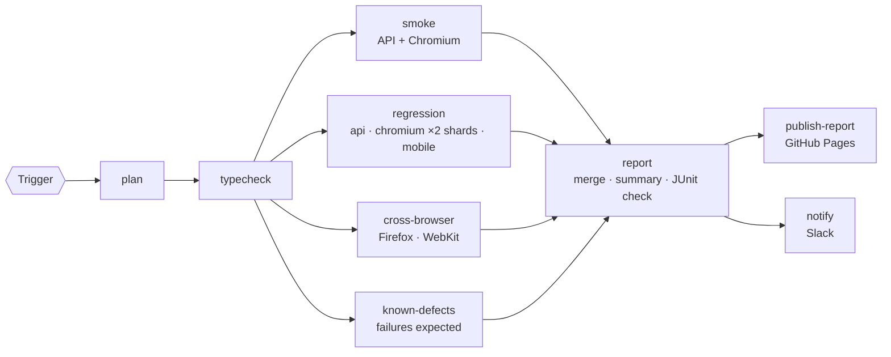

# CI/CD pipeline — GitHub Actions

Workflow: `.github/workflows/e2e.yml` · shared setup: `.github/actions/setup-playwright`



## What runs when

| Trigger | Suites | Site | Write tests |
|---|---|---|---|
| Push to `main`, pull request | smoke | `BASE_URL` var (default cloud7.io) | no |
| `repository_dispatch: cloud7-deployed` (website deploy finished) | smoke | `client_payload.base_url`, else default | no |
| Nightly 01:00 Cairo | regression + cross-browser + known-defects | `STAGING_URL` if set, else default | only if `STAGING_URL` is set |
| Manual (**Run workflow**) | your choice: smoke / regression / cross-browser / known-defects / all | your input, else default | your checkbox |

## Jobs

| Job | What it does | Fails the run? |
|---|---|---|
| **plan** | Decides suites, site and write mode; writes a plan table to the run summary | on invalid URL |
| **typecheck** | `tsc` + `playwright test --list` — catches broken code before any browser starts | yes |
| **smoke** | `@smoke` tests on API + Chromium, known defects skipped (~5 min). Use as the required PR check | yes |
| **regression** | All tests, known defects skipped. Matrix: `api`, `chromium` split into 2 shards, `mobile-chrome` | yes |
| **cross-browser** | All UI tests on Firefox and WebKit (Safari engine) | yes |
| **known-defects** | Only `@known-defect` tests, no retries. Failures are expected and don't fail the run | no |
| **report** | Merges every job's blob into one HTML report, JUnit and JSON; writes the summary; adds a **Playwright results** check | no |
| **publish-report** | Deploys the latest nightly HTML report to GitHub Pages (opt-in) | no |
| **notify** | Slack message when anything failed, or when a known defect starts passing (not on PRs) | no |

The run summary shows passed / new failures / flaky / known defects, a per-project table, each new failure with its file, flow and error, and a **🎉 Known defects now passing** list telling you which `@known-defect` tags to remove.

## One-time setup

1. **Push the project** to a GitHub repo. Commit `package-lock.json` after your first `npm install` (the pipeline uses `npm ci` when it's there).
2. **Variables** — *Settings → Secrets and variables → Actions → Variables*

   | Variable | Example | Purpose |
   |---|---|---|
   | `BASE_URL` | `https://cloud7.io` | Default site (optional; this is the default) |
   | `STAGING_URL` | `https://staging.cloud7.io` | Nightly runs go here and enable `@write` tests |
   | `PUBLISH_REPORT_TO_PAGES` | `true` | Turn on the Pages report |

3. **Secrets** — *Settings → Secrets and variables → Actions → Secrets* (all optional)

   | Secret | Purpose |
   |---|---|
   | `RECAPTCHA_TEST_TOKEN` | API-008 on staging (staging must use Google's reCAPTCHA v2 test keys) |
   | `MAILOSAUR_API_KEY`, `MAILOSAUR_SERVER_ID` | Read the demo-access email (UI-015) |
   | `SLACK_WEBHOOK_URL` | Slack alerts (incoming webhook) |

4. **GitHub Pages** (if enabled above) — *Settings → Pages → Source: GitHub Actions*. The report is private-repo-visible only on paid plans; on a public repo it's public.
5. **Branch protection** — *Settings → Branches → main*: require the **typecheck** and **smoke** checks before merging.

`ALLOW_PROD_WRITES` is deliberately never set in CI, so the pipeline can't send real leads to cloud7.io.

## Trigger after a website deploy

Add this as the last step of the website's deploy pipeline (token needs `repo` scope or a fine-grained token with *Actions: write* on this repo):

```bash
curl -sS -X POST \
  -H "Authorization: Bearer $E2E_REPO_TOKEN" \
  -H "Accept: application/vnd.github+json" \
  https://api.github.com/repos/<owner>/<repo>/dispatches \
  -d '{"event_type":"cloud7-deployed","client_payload":{"base_url":"https://cloud7.io"}}'
```

## Run manually

Actions tab → **cloud7 E2E** → **Run workflow**, or with the GitHub CLI:

```bash
gh workflow run e2e.yml -f suite=regression
gh workflow run e2e.yml -f suite=all -f base_url=https://staging.cloud7.io -f write_tests=true
```

## Reports

- **Run summary** — on the run page.
- **HTML report** — artifact `playwright-report` (14 days); download, unzip, `npx playwright show-report playwright-report`. Failed tests include trace, video and screenshot.
- **Pages** — latest nightly at your Pages URL, if enabled.

## Scaling later

- More shards: add `{ project: chromium, shardIndex: 3, shardTotal: 3 }` rows and bump `shardTotal` on the others.
- Portal/platform flows (E2E-03 to E2E-08): add their projects to the regression matrix and secrets for the demo tenant.
